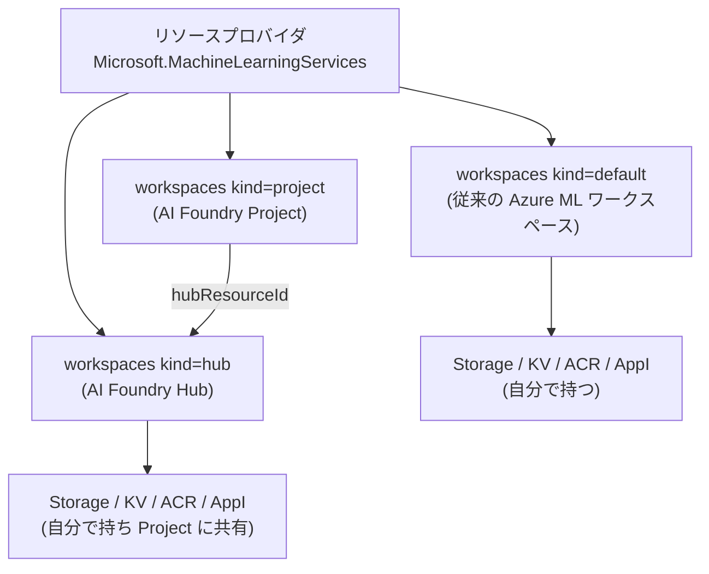
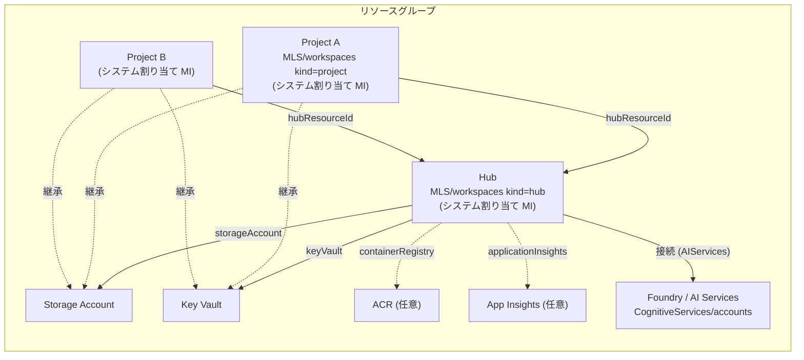

# 01. 必要な外部リソースとその関係性

← [README](README.md)

## 0. 前提: AI Foundry (Hub / Project) と Azure Machine Learning の関係

Microsoft Q&A や GitHub Issue では「Azure ML ワークスペース」として書かれている情報が多い。
それらが AI Foundry (Hub ベース) に当てはまるかどうかを判断するために、両者の関係を先に整理する。

### 0.1 結論: Hub も Project も「Azure ML ワークスペース」の一種 (kind 違い) **(A)**

| 呼び方 | ARM リソース型 | `kind` | 依存リソース (Storage / KV 等) | 使えるポータル |
|---|---|---|---|---|
| Azure ML ワークスペース (従来) | `Microsoft.MachineLearningServices/workspaces` | `default` | **自分で持つ** | ML Studio |
| **AI Foundry Hub** | `Microsoft.MachineLearningServices/workspaces` | **`hub`** | **自分で持つ** (Project に共有) | Foundry (classic) / ML Studio |
| **AI Foundry Project (Hub ベース)** | `Microsoft.MachineLearningServices/workspaces` | **`project`** | **持たない** (Hub から継承) | Foundry (classic) / ML Studio |
| (参考) Foundry リソース (新) | `Microsoft.CognitiveServices/accounts` (+ `/projects`) | `AIServices` | 既定は Microsoft 管理 | Foundry (新) |

一次情報の記述:

- 「Foundry AI Hub is an **implementation of Azure Machine Learning** and requires multiple Azure services as dependencies.」
  リソース表で Hub は `Microsoft.MachineLearningServices/workspace` / kind `hub`、Hub の Project は同じ型の kind `project`
  ([ai-resources](https://learn.microsoft.com/en-us/azure/foundry-classic/concepts/ai-resources), ms.date 2025-12-24)
- 「Hub workspaces are **the same resource type as Microsoft Foundry hubs**, so you can use them from both Azure Machine Learning studio and Foundry.」
  ([concept-workspace](https://learn.microsoft.com/en-us/azure/machine-learning/concept-workspace?view=azureml-api-2), ms.date 2026-02-10)
- 「Hub resources are available in Foundry portal, Azure Machine Learning studio, and the Azure portal.」(A1)
- ワークスペースの kind は `default` / `hub` / `project` の 3 種類
  ([identity-based auth - Default behavior by workspace kind](https://learn.microsoft.com/en-us/azure/machine-learning/how-to-identity-based-service-authentication?view=azureml-api-2))
- Terraform の `azurerm_ai_foundry` / `azurerm_ai_foundry_project` も実体はこのリソース型 (C: `../ai_foundry_keyvault_relation/README.md` のスコープ注記)

### 0.2 Azure ML 向けの情報を AI Foundry に当てはめるときの考え方

| Azure ML の情報の種類 | Hub に当てはまるか | Project に当てはまるか | 理由 / 確度 |
|---|---|---|---|
| 依存リソースの作成・権限付与 (KV / Storage への処理) | **当てはまる** | **一部**。依存リソースは持たないが、自分の MI への権限付与は受ける | 同じ RP・同じ型で、依存リソースを持つのは `default` と `hub`。Project の MI にも KV のアクセスポリシーが付く (A + C) |
| マネージド ID の権限 (concept-enterprise-security の表) | 当てはまる | 当てはまる | ワークスペース共通の記述 (A)。ただし 2024-11-19 以降は Contributor ではなく Azure AI Administrator (A) |
| データ分離 (`enableDataIsolation`) | 既定で有効 | 既定で有効 (継承) | `default` は既定で無効なので、Azure ML の記事の例とは前提が違う (A) |
| コンピュートクラスター、BYO VNet など | **当てはまらない** | 当てはまらない | Hub / Project ではサポートされない機能がある (A, concept-hub-workspace の比較表) |

ポイント: **Key Vault / Storage に対する処理は、依存リソースを持つワークスペース (= `default` または `hub`) を作ったときの RP の挙動**である。
AI Foundry では **Hub の作成が Azure ML ワークスペースの作成に当たる**。
Project の作成は「Hub の依存リソースに、Project の MI 用の権限を足す」処理に当たる。

## 1. 依存リソースの一覧 (Hub ベース)

Hub は「Azure Machine Learning の実装」であり、複数の Azure サービスに依存する。
指定しなければ自動作成される。 **(A)**
出典: [Hubs and hub-based project overview (classic)](https://learn.microsoft.com/en-us/azure/foundry-classic/concepts/ai-resources) (ms.date 2025-12-24)

| 依存リソース | プロバイダ | 必須/任意 | 用途 (Learn の記載) | Project 間の分離方法 (Learn の記載) |
|---|---|---|---|---|
| Microsoft Foundry (AI Services) | `Microsoft.CognitiveServices/accounts` | 必須 | モデルや Foundry のコア API へのアクセス | - |
| **Storage Account** | `Microsoft.Storage/storageAccounts` | **必須** | flow や評価結果などプロジェクトの成果物を保存 | コンテナ名に **Project の GUID を接頭辞**として付け、**Azure ABAC の条件付きロール**で Project の ID からのみアクセスできるようにする |
| **Key Vault** | `Microsoft.KeyVault/vaults` | **必須** | 接続の接続文字列などのシークレットを保存 | **API 経由では他 Project のシークレットを取得できない** |
| Container Registry | `Microsoft.ContainerRegistry/registries` | 任意 | prompt flow のカスタムランタイムで作る Docker イメージ | イメージ名に Project の GUID を接頭辞 |
| Application Insights + Log Analytics | `Microsoft.Insights/components`, `Microsoft.OperationalInsights/workspaces` | 任意 | デプロイした prompt flow のアプリログ (オプトイン時) | - |
| Azure AI Search | `Microsoft.Search/searchServices` | 任意 | 検索機能 | - |

> Key Vault の分離は「**API 経由では**取得できない」という書き方である点に注意。
> Key Vault 自体のアクセス制御で Project ごとに分けている、とは書かれていない。
> 詳しくは [03 §3.3](03_keyvault-activities.md) を参照。

Azure ML 側のドキュメントにも同じ依存関係が書かれている。 **(A)**
出典: [What is a workspace? - Associated resources](https://learn.microsoft.com/en-us/azure/machine-learning/concept-workspace?view=azureml-api-2) (ms.date 2026-02-10)

- Storage: ジョブログなどの成果物、データアップロード先の既定、コンピュートインスタンスのノートブック
- Key Vault: 「コンピュートターゲットが使うシークレットや、ワークスペースが必要とするその他の機微情報」
- ACR: カスタム環境のビルド時。不要なら ACR なしで作成できる
- App Insights: 推論エンドポイントの監視

### Storage Account の制約 (既存のものを持ち込む場合) **(A)**

[concept-workspace](https://learn.microsoft.com/en-us/azure/machine-learning/concept-workspace?view=azureml-api-2) と
[how-to-manage-workspace](https://learn.microsoft.com/en-us/azure/machine-learning/how-to-manage-workspace?view=azureml-api-2) より:

- `BlobStorage` 種別、Premium (Premium_LRS / Premium_GRS)、**階層型名前空間 (ADLS Gen2) が有効**なものは既定ストレージにできない
- HNS や Premium は「追加のデータストア」としてなら使える
- 別サブスクリプションの Storage / KV を使う場合は、そのサブスクリプションに `Microsoft.MachineLearningServices` を登録しておく必要がある

## 2. 関係性

### 2.1 全体像

- 依存リソースは **Hub に 1 セット**だけ紐づく。Project は作成時に依存リソースを指定せず、Hub のものを継承する。 **(A)**
  - 「Project workspaces ... don't require their own security settings or Azure associated resources.」
    ([concept-hub-workspace](https://learn.microsoft.com/en-us/azure/machine-learning/concept-hub-workspace?view=azureml-api-2), ms.date 2026-03-26)
- Hub と Project はどちらも**それぞれ独立したトップレベルの Azure リソース**で、それぞれがシステム割り当てマネージド ID を持つ。
  このため、依存リソース側には **Hub と Project の両方の ID** に対する権限付与が発生する。 **(A + C)**
  - これが Key Vault の `Update Access Policy` の開始者が **Hub と Project の両方**だった理由
    ([03](03_keyvault-activities.md) 参照)。

### 2.2 Hub と Project の間で共有されるもの **(A)**

[concept-hub-workspace](https://learn.microsoft.com/en-us/azure/machine-learning/concept-hub-workspace?view=azureml-api-2) の表を要約:

| 項目 | 振る舞い |
|---|---|
| ネットワーク | マネージド VNet は Hub と Project で 1 つを共有。Private Endpoint も Hub に 1 つ作ればよい |
| 暗号化 | CMK 設定は Hub から Project に引き継がれる |
| Storage | Project は `{workspaceGUID}` で始まる専用コンテナを使い、ワークスペース ID への **ABAC 条件付きロール**でそのコンテナだけにアクセスする |
| Key Vault | サービス内で作られるシークレット (例: 接続作成時) を保存。**Project の ID は自分のシークレットにしかアクセスできない** |
| ACR | 命名規則でイメージを分離 |
| App Insights | 1 つを全 Project の既定にできる。Project 単位で上書き可 |

### 2.3 マネージド ID と権限の関係 **(A)**

[Enterprise security and governance](https://learn.microsoft.com/en-us/azure/machine-learning/concept-enterprise-security?view=azureml-api-2) (ms.date 2025-10-30) では、
ワークスペースのシステム割り当て MI が関連リソースに持つ権限を次のように記載している。

| リソース | 権限 |
|---|---|
| Workspace | Contributor |
| Storage account | Storage Blob Data Contributor |
| **Key vault** | **Access to all keys, secrets, certificates** |
| Container registry | Contributor |
| ワークスペースを含むリソースグループ | Contributor |

あわせて次の注意書きがある。

> Don't revoke the access of the managed identity to the resources mentioned in the preceding table.
> You can restore access by using the resync keys operation.

- 2024-11-19 以降に作成した Hub は、MI に付くロールが **Contributor ではなく Azure AI Administrator** になった
  ([hub-rbac-foundry](https://learn.microsoft.com/en-us/azure/foundry-classic/concepts/hub-rbac-foundry), ms.date 2025-12-31)。
  Azure AI Administrator には `Microsoft.KeyVault/*`、`Microsoft.Storage/storageAccounts/*`、
  `Microsoft.Insights/diagnosticSettings/*` が含まれる。
  → RP が Key Vault のアクセスポリシーや診断設定を書き換えられるのは、この権限による (A + D)。

### 2.4 実機で確認された自動ロール付与 **(C)**

`../ai_foundry/README.md` §4.1 (Key Vault は **RBAC モデル**) で、apply 後に確認された内容:

| プリンシパル | ロール | スコープ |
|---|---|---|
| Hub MI | Storage Blob Data Contributor / Storage File Data Privileged Contributor | Hub 用 Storage |
| Hub MI | **Key Vault Administrator** | Key Vault |
| Project MI | 上記に加えて Storage Account Contributor / Reader / Azure AI Administrator | 各スコープ |

→ Terraform で同じロール割り当てを宣言すると `409 RoleAssignmentExists` になる。

## 3. 作成後に変えられないもの・注意点

| 項目 | 内容 | 確度 |
|---|---|---|
| データ分離 (`enableDataIsolation`) | **作成時にしか設定できない**。Hub / Project では既定で有効 | A ([identity-based auth](https://learn.microsoft.com/en-us/azure/machine-learning/how-to-identity-based-service-authentication?view=azureml-api-2)) |
| App Insights | ワークスペースが作ったものを削除すると、作り直すには**ワークスペースの再作成**が必要 | A ([how-to-manage-workspace](https://learn.microsoft.com/en-us/azure/machine-learning/how-to-manage-workspace?view=azureml-api-2)) |
| ACR | 一度作られた ACR を削除すると**ワークスペースが動かなくなる** | A (同上) |
| ワークスペース削除 | 既定では依存リソースは**削除されない** (`delete_dependent_resources=True` で一緒に削除) | A (同上) |
| Key Vault (資格情報ストア) | Hub 作成ポータルの Storage タブで「Credential store」として選ぶ | A ([create-secure-ai-hub](https://learn.microsoft.com/en-us/azure/foundry-classic/how-to/create-secure-ai-hub)) |
| HBI ワークスペース | 作成時のみ設定可 | A |

## 4. 参考: 新しい Foundry リソースとの違い **(A)**

[Microsoft Foundry architecture](https://learn.microsoft.com/en-us/azure/foundry/concepts/architecture) (ms.date 2026-08-21)、
[Set up an Azure Key Vault Connection](https://learn.microsoft.com/en-us/azure/foundry/how-to/set-up-key-vault-connection) (ms.date 2026-08-14) より:

| 観点 | Hub ベース (classic) | Foundry リソース (新) |
|---|---|---|
| Storage | 必須 (顧客のサブスクリプション内) | 既定は **Microsoft 管理ストレージ**。BYO は任意 (評価・バッチ、Agent の standard setup など) |
| Key Vault | 必須 (顧客のサブスクリプション内) | 既定は **Microsoft 管理の Key Vault (サブスクリプション外)**。BYO は「Key Vault 接続」で 1 リソースにつき 1 つ |
| KV の権限付与 | RP が自動 (アクセスポリシー / ロール) | **利用者が付与** (Key Vault Secrets Officer 以上を Foundry の MI に) |
| シークレット移行 | - | **非対応**。KV 接続は他の接続より**先に**作る必要がある |
| 接続リソースの位置づけ | Hub が持つ依存リソース | 「独立したガバナンス境界を持つ接続先リソース」 |
